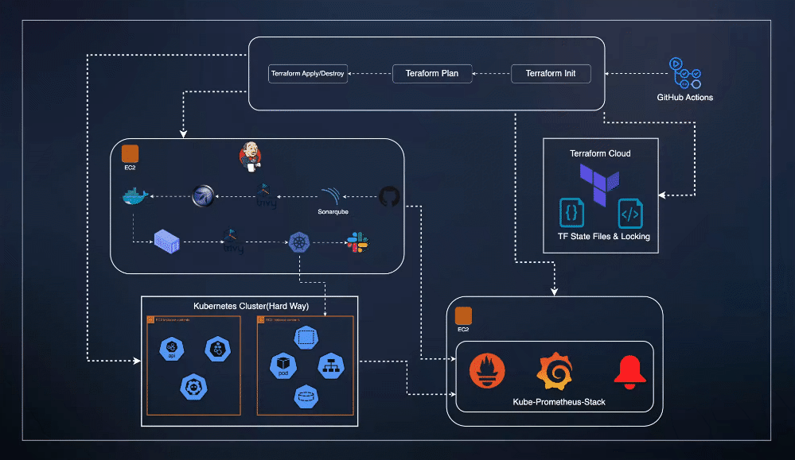

# 🎬 Enterprise DevSecOps Architecture & CI/CD Pipeline

> **A comprehensive end-to-end DevSecOps engineering project demonstrating Infrastructure-as-Code (Terraform on AWS), automated CI/CD pipelines (Jenkins & GitHub Actions), shift-left security analysis (Trivy, SonarQube, OWASP), container orchestration (Kubernetes), and full-stack observability (Prometheus & Node Exporter).**

[](#)
[](#)
[](#)
[](#)
[](#)
[](#)
[](#)

---

## 🏗️ Architecture & DevSecOps Workflow

<p align="center">
  
</p>

This architecture demonstrates a production-grade enterprise setup where a high-performance streaming web application (**NebulaStream**) is automatically provisioned, tested, scanned for vulnerabilities, containerized, and deployed to an unmanaged Kubernetes cluster with continuous observability.

---

## 🚀 Key DevSecOps Pillars

### 1. 🌐 Infrastructure as Code (IaC) — AWS & Terraform
* **Modular VPC Networking:** Configures public/private subnets, Internet Gateways, Route Tables, and strict Security Groups.
* **IAM Least-Privilege Roles:** Fine-grained policies for Jenkins automation servers and worker nodes.
* **Terraform Cloud Remote State:** Centralized state locking, versioning, and team collaboration.

### 2. ⚙️ Automated CI/CD Pipeline — Jenkins & GitHub Actions
* **Multi-Stage Jenkinsfile:** Triggered automatically via GitHub webhooks.
* **Pipeline Flow:** `Code Checkout` ➔ `Node Dependencies & Build` ➔ `SonarQube Static Analysis` ➔ `OWASP Dependency Scan` ➔ `Docker Container Build` ➔ `Trivy Vulnerability Audit` ➔ `Image Push to Registry` ➔ `Kubernetes Deployment`.

### 3. 🛡️ Shift-Left Security & Vulnerability Scanning
* **SonarQube Quality Gates:** Automated code smell, bug detection, and code coverage verification.
* **OWASP Dependency-Check:** Audits third-party npm packages for known CVE vulnerabilities.
* **Trivy Container Scanning:** Scans base images and root filesystems before allowing images to be pushed.

### 4. ☸️ Container Orchestration — Kubernetes
* **Resilient Pod Deployments:** Declarative rollout manifests with health checks (`livenessProbe` and `readinessProbe`).
* **Service Exposure:** Configures ClusterIP and LoadBalancer services for reliable traffic routing.

### 5. 📊 Observability & System Monitoring
* **Prometheus Server:** Time-series metric collection across cluster nodes and running applications.
* **Node Exporter:** Real-time host CPU, memory, disk I/O, and network telemetry.
* **Kube-State-Metrics:** Cluster-level pod health, replica counts, and deployment status tracking.

---

## 📂 Project Directory Structure

```
DevOps/
├── assets/
│   └── arch-diag.gif        # High-definition animated architecture diagram
└── NebulaStream/
    ├── Application-Code/    # Frontend React application (Netflix theme)
    │   ├── Dockerfile       # Container definition
    │   ├── package.json     # App dependencies
    │   └── src/             # Component source code
    ├── Jenkins/
    │   └── Jenkinsfile      # Declarative CI/CD pipeline script
    ├── Kubernetes/
    │   ├── deployment.yml   # K8s deployment specification
    │   └── service.yml      # K8s network service exposure
    ├── Terraform/
    │   ├── main.tf          # Core AWS resource provisioning
    │   ├── vpc.tf           # Virtual Private Cloud configuration
    │   ├── iam.tf           # IAM roles & security policies
    │   ├── backend.tf       # Remote state storage
    │   └── variables.tf     # Configurable infrastructure variables
    └── Mobile-LLM/          # On-device AI/ML integration modules
```

---

## 🛠️ Step-by-Step Deployment Guide

### Phase 1: Provision Infrastructure with Terraform
```bash
cd NebulaStream/Terraform
terraform init
terraform plan
terraform apply --auto-approve
```

### Phase 2: Configure Jenkins Pipeline
1. Add AWS and Docker Hub credentials to the Jenkins Credential Manager.
2. Configure SonarQube Server and Trivy scanner in **Global Tool Configuration**.
3. Create a **Pipeline** job pointing to `NebulaStream/Jenkins/Jenkinsfile`.
4. Trigger the build to initiate automated testing, scanning, and containerization.

### Phase 3: Deploy to Kubernetes Cluster
```bash
kubectl apply -f NebulaStream/Kubernetes/deployment.yml
kubectl apply -f NebulaStream/Kubernetes/service.yml
kubectl get pods -o wide
kubectl get svc
```

### Phase 4: Verify Monitoring
* Access Prometheus Dashboard on port `9090` to observe cluster metrics.
* Verify real-time target status for Node Exporter and Kube-State-Metrics.

---

## 📄 License
This project is licensed under the [MIT License](LICENSE).
